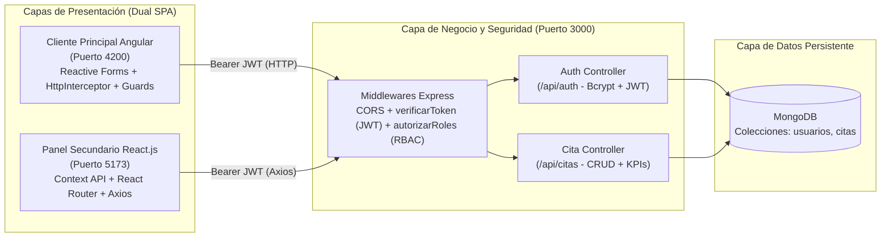

# 📄 Informe Técnico — Proyecto Integrador Full Stack (PA3)
## Sistema Clínico de Gestión de Citas Médicas — **Medisys v3.0**

- **Curso:** Área Integradora — Proyecto de Desarrollo Web Full (PA3)
- **Autor:** Jose Fernando Frias Diaz (`fernandofriasdiaz0-droid`)
- **Repositorio GitHub:** `https://github.com/fernandofriasdiaz0-droid/PA3.programacion.web`
- **Stack Tecnológico:** Angular (Cliente Principal) + React.js (Panel Secundario) + Node.js / Express + MongoDB / Mongoose + Seguridad JWT & Bcrypt

---

## 1. Arquitectura General del Sistema

El sistema **Medisys v3.0** implementa una arquitectura **Full Stack Multi-Cliente (Dual SPA)** desacoplada y orientada a servicios RESTful:



---

## 2. Estructura del Proyecto

```text
PA3.programacion.web/
├── .vscode/                        # Tareas automáticas para levantar los 3 servidores en paralelo
├── backend/                        # API REST en Node.js + Express + TypeScript (Puerto 3000)
│   ├── data/
│   │   ├── seed-citas.json         # Registros de prueba de citas médicas
│   │   └── seed-usuarios.json      # Usuarios de prueba con roles (admin, medico, recepcionista)
│   ├── src/
│   │   ├── config/database.ts      # Conexión a MongoDB (Local / Atlas / In-Memory Fallback)
│   │   ├── controllers/
│   │   │   ├── auth.controller.ts  # Registro, Login, Perfil y Gestión de Roles
│   │   │   └── cita.controller.ts  # Operaciones CRUD, filtros y estadísticas
│   │   ├── middlewares/
│   │   │   └── auth.middleware.ts  # Verificación JWT y autorización RBAC por roles
│   │   ├── models/
│   │   │   ├── cita.model.ts       # Esquema Mongoose de Citas Médicas
│   │   │   └── usuario.model.ts    # Esquema Mongoose de Usuarios con hash Bcrypt
│   │   ├── routes/
│   │   │   ├── auth.routes.ts      # Endpoints /api/auth/*
│   │   │   └── cita.routes.ts      # Endpoints protegidos /api/citas/*
│   │   ├── seeds/seedData.ts       # Carga inicial automática de usuarios y citas
│   │   ├── types/                  # Interfaces, Enums y Genéricos TypeScript (T01, T02)
│   │   └── server.ts               # Punto de entrada del servidor Express
│   └── .env.example                # Plantilla de variables de entorno sin credenciales reales
├── frontend/                       # Interfaz Principal en Angular (Puerto 4200 - T03, T04)
│   └── src/app/
│       ├── core/
│       │   ├── guards/             # authGuard y roleGuard
│       │   ├── interceptors/       # authInterceptor funcional (JWT y manejo 401/403)
│       │   ├── models/             # Interfaces de Cita y Autenticación
│       │   └── services/           # AuthService, CitaService y NotificationService
│       ├── features/
│       │   ├── auth/               # LoginComponent y RegisterComponent
│       │   ├── cita-form/          # Formulario reactivo de creación/edición
│       │   ├── cita-list/          # Tabla con filtros y confirmación de eliminación
│       │   └── dashboard/          # Panel principal de métricas
│       └── shared/components/      # NavbarComponent y ConfirmModalComponent
├── panel-react/                    # Panel Secundario en React.js + Vite (Puerto 5173 - T09, T10, T11)
│   └── src/
│       ├── components/             # NavbarReact y ProtectedRoute
│       ├── context/                # GlobalStateContext (Context API + useReducer)
│       ├── pages/
│       │   ├── LoginPage.tsx       # Inicio de sesión y registro en React
│       │   ├── ExecutivePanelPage.tsx # Centro ejecutivo analítico y control rápido
│       │   ├── CitasManagerPage.tsx   # Gestor CRUD completo desde React
│       │   └── SecurityAuditPage.tsx  # Inspector JWT, simulador 401 y matriz RBAC
│       ├── services/api.ts         # Instancia Axios con interceptores JWT
│       └── types/medisys.types.ts  # Tipos compartidos TypeScript
├── docs/
│   ├── BANCO_22_EJERCICIOS_PA3.md  # Anexo con los 22 ejercicios resueltos (T01–T11)
│   ├── INFORME_TECNICO_PA3.md      # Presente informe técnico detallado
│   └── capturas/                   # Evidencias gráficas del sistema
├── .env.example                    # Variables de entorno de ejemplo
├── CHANGELOG.md                    # Bitácora de refactorización y cambios (T08)
└── README.md                       # Manual de instalación y ejecución rápida
```

---

## 3. Modelo de Datos en MongoDB (T06 y T07)

### 3.1. Colección `usuarios` (`UsuarioModel`)
| Campo | Tipo | Restricciones / Validaciones | Descripción |
| :--- | :--- | :--- | :--- |
| `_id` | `ObjectId` | Autogenerado por MongoDB | Identificador único del usuario |
| `nombre` | `String` | `required`, `minlength: 3`, `trim` | Nombre completo del profesional o usuario |
| `email` | `String` | `required`, `unique`, `lowercase`, `regex` | Correo electrónico único de acceso |
| `password` | `String` | `required`, `minlength: 6`, `select: false` | Hash encriptado con `bcryptjs` (10 rondas) |
| `rol` | `String` | `enum: ['admin', 'medico', 'recepcionista']` | Nivel de permisos para control RBAC |
| `especialidad` | `String` | `default: 'General'` | Área clínica o administrativa |
| `activo` | `Boolean` | `default: true` | Estado de la cuenta |
| `ultimoAcceso` | `Date` | `default: Date.now` | Registro de última autenticación exitosa |

### 3.2. Colección `citas` (`CitaModel`)
| Campo | Tipo | Restricciones / Validaciones | Descripción |
| :--- | :--- | :--- | :--- |
| `_id` | `ObjectId` | Autogenerado por MongoDB | Identificador único de la cita |
| `cliente` | `String` | `required`, `minlength: 3` | Nombre completo del paciente |
| `email` | `String` | `required`, `match: regex email` | Correo de contacto del paciente |
| `telefono` | `String` | `required` | Teléfono del paciente |
| `especialidad` | `String` | `required` | Especialidad médica seleccionada |
| `profesional` | `String` | `required` | Médico asignado a la consulta |
| `fecha` / `hora` | `String` | `YYYY-MM-DD` / `HH:mm` | Programación cronológica de la cita |
| `motivo` | `String` | `required`, `minlength: 5` | Descripción clínica del motivo de consulta |
| `estado` | `String` | `enum: ['Pendiente', 'Confirmada', 'En Atención', 'Completada', 'Cancelada']` | Estado actual del flujo clínico |
| `prioridad` | `String` | `enum: ['Baja', 'Media', 'Alta', 'Urgente']` | Nivel de triaje |
| `costo` | `Number` | `required`, `min: 0` | Costo de la atención en soles (`S/`) |
| `creadoPor` | `String` | `default: 'Sistema Medisys'` | Usuario autenticado y rol que creó el registro |

---

## 4. Endpoints de la API REST y Matriz de Seguridad JWT (T05, T07)

| Método | Endpoint | Protección JWT | Roles Autorizados (RBAC) | Descripción |
| :--- | :--- | :---: | :---: | :--- |
| `GET` | `/api/health` | Público | Todos | Verifica estado del servidor y modo de base de datos |
| `POST` | `/api/auth/register` | Público | Todos | Registra un nuevo usuario con hash `bcrypt` y retorna token JWT |
| `POST` | `/api/auth/login` | Público | Todos | Valida credenciales con `bcrypt.compare` y emite token JWT |
| `GET` | `/api/auth/perfil` | `Bearer JWT` | `admin`, `medico`, `recepcionista` | Devuelve el perfil del usuario autenticado y metadatos del token |
| `GET` | `/api/auth/usuarios` | `Bearer JWT` | `admin`, `medico`, `recepcionista` | Lista los usuarios registrados en MongoDB |
| `PATCH` | `/api/auth/usuarios/:id/rol` | `Bearer JWT` | **Solo `admin`** | Actualiza el rol de un usuario en MongoDB |
| `GET` | `/api/citas` | `Bearer JWT` | `admin`, `medico`, `recepcionista` | Consulta citas con filtros opcionales (`buscar`, `estado`, `especialidad`, `prioridad`) |
| `GET` | `/api/citas/estadisticas` | `Bearer JWT` | `admin`, `medico`, `recepcionista` | Calcula KPIs agregados, ingresos y distribución por especialidad/prioridad |
| `GET` | `/api/citas/:id` | `Bearer JWT` | `admin`, `medico`, `recepcionista` | Obtiene el detalle de una cita por su `ObjectId` |
| `POST` | `/api/citas` | `Bearer JWT` | `admin`, `medico`, `recepcionista` | Crea una nueva cita médica persistente en MongoDB |
| `PUT` | `/api/citas/:id` | `Bearer JWT` | `admin`, `medico`, `recepcionista` | Actualiza los datos o el estado de una cita existente |
| `DELETE` | `/api/citas/:id` | `Bearer JWT` | **Solo `admin`** | Elimina permanentemente una cita de MongoDB (devuelve `403` a otros roles) |
| `POST` | `/api/citas/seed` | `Bearer JWT` | **Solo `admin`** | Restaura las 6 citas de prueba iniciales en MongoDB |

---

## 5. Pruebas de Validación Ejecutadas

1. **Prueba de Autenticación y Encriptación (`T07`):**
   - Inicio de sesión exitoso con las 3 cuentas semilla (`admin@medisys.com`, `medico@medisys.com`, `recepcion@medisys.com`) verificando que las contraseñas están almacenadas con hash `bcrypt` en MongoDB.
2. **Prueba de Autorización por Roles RBAC (`T07`):**
   - Al iniciar sesión como `medico` o `recepcionista` e intentar eliminar una cita (`DELETE /api/citas/:id`) o restaurar el seed (`POST /api/citas/seed`), el backend rechaza la petición con estado `403 Forbidden` y muestra una notificación explicativa. Al iniciar sesión como `admin`, ambas operaciones se ejecutan satisfactoriamente.
3. **Prueba de Sincronización en Tiempo Real entre Angular y React (`T03`, `T09`, `T10`):**
   - Una cita creada o cambiada de estado en el **Panel React (`:5173`)** se persiste en MongoDB y se visualiza de inmediato en la **Interfaz Principal Angular (`:4200`)**, y viceversa.
4. **Prueba de Expiración de Token JWT (`T04`, `T11`):**
   - Desde la vista `/seguridad` del Panel React, al pulsar **"Probar Expiración de Token (T11)"**, el interceptor Axios detecta la respuesta `401 Unauthorized`, limpia la sesión local, muestra la notificación de sesión expirada y redirige automáticamente a `/login`.

---

## 6. Conclusiones

1. La evolución del sistema **Medisys** de la **PA2** a la **PA3** demuestra cómo una API REST bien estructurada en **Node.js, Express y MongoDB** permite escalar hacia una arquitectura **Multi-Cliente** donde **Angular** (como aplicación operativa principal) y **React.js** (como panel secundario ejecutivo y de auditoría) operan de forma simultánea y consistente sobre la misma fuente de datos.
2. La incorporación de **Bcrypt**, **JSON Web Tokens (JWT)**, middlewares de autorización por roles (**RBAC**) e interceptores HTTP tanto en Angular (`HttpInterceptorFn`) como en React (`Axios Interceptors`) garantiza seguridad de extremo a extremo y una experiencia de usuario fluida ante la expiración de sesiones.
3. El uso de **Context API + `useReducer`** en React y servicios reactivos con RxJS en Angular, respaldados por **TypeScript estricto** en las tres capas, asegura mantenibilidad, escalabilidad y cero discrepancias de tipos entre cliente y servidor.

